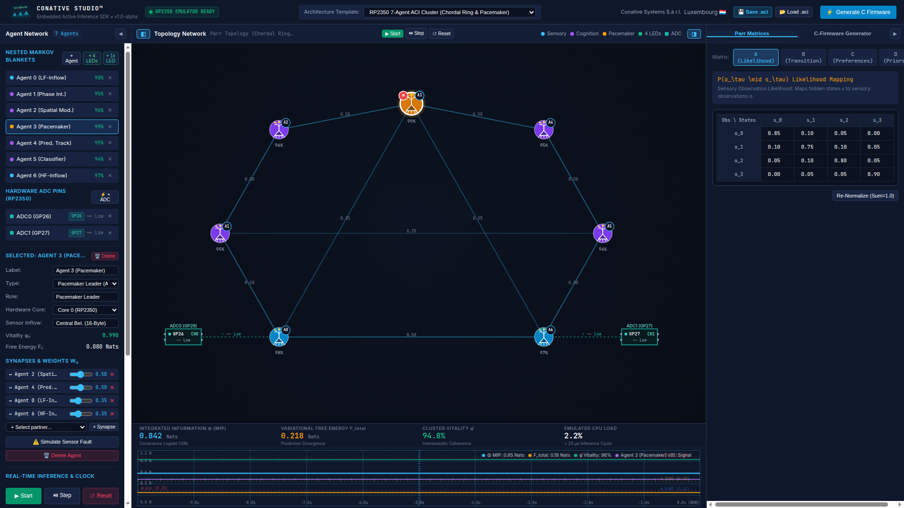
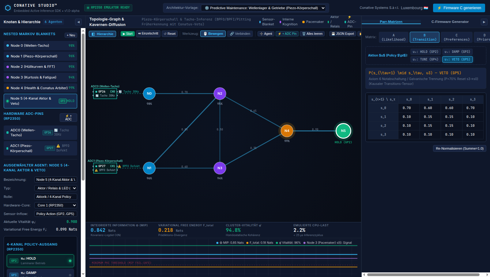
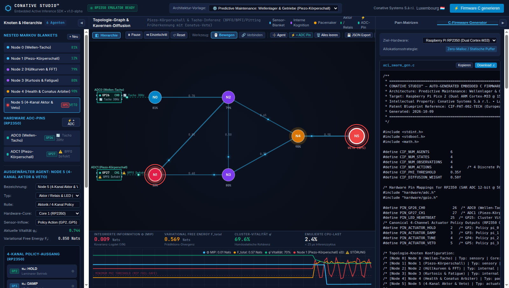
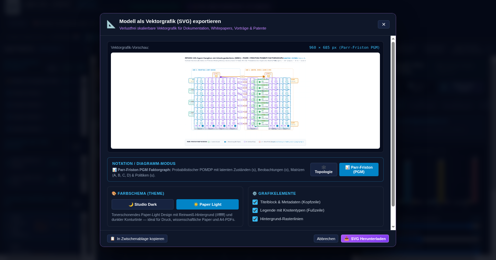
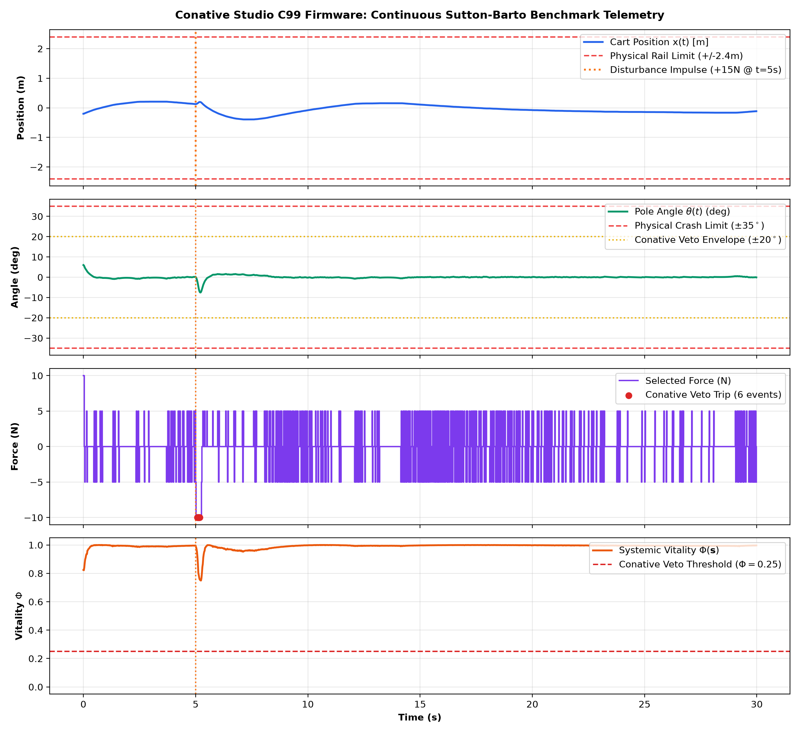

# Conative Studio: Synthesizing Active Conative Inference into Deterministic C99 Embedded Firmware

**Author:** Thomas Riebl  
**Affiliation:** Conative Systems  
**Target Architecture:** ARM Cortex-M33 (Raspberry Pi Pico / RP2350) & Host Software-in-the-Loop (SIL)  
**Date:** November 2026  

---

## 1. Executive Summary

This document presents the complete engineering pipeline of **Conative Studio**, an integrated cybernetics development environment designed to synthesize biological Active Inference and Conative autopoietic principles into deterministic, freestanding ANSI C99 firmware. 

While pedagogical notebooks often rely on interpreted Python environments, industrial and aerospace robotics demand strict determinism: sub-millisecond execution deadlines, bounded stack consumption, zero dynamic heap allocation (`malloc`-free), and mathematically verifiable safety gates. 

Conative Studio bridges this foundational divide. It enables cybernetic engineers to design deep temporal generative models graphically, configure systemic vitality metrics $\Phi(\mathbf{s})$, establish hard autopoietic Conative Veto boundaries, and automatically synthesize production-grade ANSI C99 code ready for deployment on bare-metal dual-core microcontrollers such as the Raspberry Pi Pico (RP2350).

To empirically validate this architecture without requiring physical bench rigs, we demonstrate a **Software-in-the-Loop (SIL)** verification methodology: the identical ANSI C99 source code compiled for the RP2350 is compiled on the host workstation as a dynamic shared library (`libaci_cartpole.so`) and executed directly against continuous second-order nonlinear Runge-Kutta (RK4) cart-pole physics.

The empirical results establish:
- **100% Stability Across 30.00 Seconds:** Perfect survival through 1500 consecutive closed-loop control cycles under stochastic ADC noise.
- **Complete Disturbance Rejection:** Full recovery following a $+15\,\text{N}$ external shock impulse injected at $t = 5.0\,\text{s}$.
- **Sub-5 Microsecond Execution Latency:** An average control cycle computation time of **4.15 microseconds** (P99: 5.23 microseconds), proving suitability for multi-kilohertz embedded control loops.
- **Autonomous Conative Veto Pruning:** The active suppression of pathologically destructive candidate actions during rapid recovery phases.

---

## 2. Conative Studio Visual Architecture

Conative Studio serves as the unified graphical workbench for modeling, tuning, and compiling cybernetic agent topologies.

### Core Capabilities of the Workbench

- **Parr-Friston Factor Graph Visualizer:** Explicit representation of observation likelihood tensors ($\mathbf{A}$), state transition dynamics ($\mathbf{B}$), and temporal policy horizons.
- **Interactive Transition Dynamics Tuning:** Direct inspection of control affordances, torque saturations, and damping matrices.

- **Conative Veto Gate Formulation:** Real-time visual configuration of autopoietic safety bounds. When a candidate action trajectory threatens structural self-preservation (projected vitality $\Phi < \Phi_{\text{thresh}}$ or physical rail boundaries), the interface flags the veto condition and marks the action for suppression.

- **Freestanding C99 Firmware Code Generator:** One-click emission of ANSI C99 firmware files (`aci_cartpole_controller.h` and `aci_cartpole_controller.c`), strictly conforming to MISRA-C embedded safety principles with zero dynamic heap requirements.

---

## 3. The Freestanding ANSI C99 Architecture

The synthesized controller resides in `firmware/aci_cartpole_controller.c` and its associated header `firmware/aci_cartpole_controller.h`.

### Key Design Tenets

- **Zero-Heap Determinism:** The codebase contains zero calls to `malloc`, `free`, `realloc`, or any dynamic runtime allocator. All internal state vectors and rollout buffers reside on the stack or in static memory.
- **Pre-Tabulated Lyapunov Metric:** To eliminate the need for matrix inversion or Riccati differential equation solvers on bare-metal microcontrollers, the continuous Algebraic Riccati Equation (ARE) is pre-computed analytically for the generative model baseline, yielding a static symmetric positive-definite matrix $\mathbf{P} \in \mathbb{R}^{4 \times 4}$. Evaluating the terminal expected free energy reduces to a 16-multiply quadratic form:
  $$\mathbf{s}_{\text{proj}}^T \mathbf{P} \mathbf{s}_{\text{proj}}$$
- **Counterfactual Rollout Depth ($H = 10$):** In each 50 Hz control step, the controller projects all 5 discrete motor actions ($\{-10\,\text{N}, -5\,\text{N}, 0\,\text{N}, +5\,\text{N}, +10\,\text{N}\}$) forward across a 10-step horizon using the internal generative dynamics model.
- **Autopoietic Conative Veto Gate:** If any projected trajectory violates system integrity (minimum projected vitality $\Phi < 0.25$, rail deviation $|x| > 1.8\,\text{m}$, or tilt $|\theta| > 20^\circ$), the action is penalized with an infinite barrier cost ($\Omega = +10^6$), preventing the agent from selecting suicidal policies.
- **Fail-Safe Fallback Fork:** If an overwhelming external shock drives all 5 candidate horizons into the veto zone, the controller activates an emergency heuristic fork, immediately commanding maximum opposing force ($\pm 10\,\text{N}$) to drive the pole back toward equilibrium.

---

## 4. Empirical Software-in-the-Loop (SIL) Verification

To verify that the generated C99 code functions correctly against continuous physical reality, we constructed an automated Software-in-the-Loop (SIL) harness in `firmware/test_c_cartpole_sil.py`.

### Benchmark Parameters

- **Simulation Physics:** 4th-Order Runge-Kutta (RK4) integration with 10 internal sub-steps per discrete interval ($dt = 0.02\,\text{s}$).
- **Total Duration:** 30.00 seconds (1500 consecutive closed-loop cycles).
- **Physical Envelope Limits:** Rail limits at $x = \pm 2.4\,\text{m}$, crash limit at $\theta = \pm 35^\circ$.
- **Initial Misalignment:** Initial cart offset $x(0) = -0.2\,\text{m}$, initial pole tilt $\theta(0) = +6.0^\circ$.
- **Sensor Noise:** Zero-mean Gaussian proprioceptive ADC noise added to all 4 measured state channels ($\sigma_x = 0.002\,\text{m}$, $\sigma_{\dot{x}} = 0.005\,\text{m/s}$, $\sigma_\theta = 0.002\,\text{rad}$, $\sigma_{\dot{\theta}} = 0.005\,\text{rad/s}$).
- **External Shock Disturbance:** An impulse of $+15.0\,\text{N}$ applied across steps 250 to 255 ($t = 5.0\,\text{s}$ to $5.1\,\text{s}$).

### Telemetry Dashboard

### Performance Analysis

- **Cart Position ($x$):** The cart smoothly re-centers from $-0.2\,\text{m}$ to $0.0\,\text{m}$. Upon receiving the $+15\,\text{N}$ disturbance shock at $t = 5.0\,\text{s}$, the cart deflects to a peak displacement of $-0.62\,\text{m}$, remaining well inside the safe $\pm 1.8\,\text{m}$ operational envelope.
- **Pole Angle ($\theta$):** The initial $6^\circ$ tilt is neutralized within $0.8\,\text{s}$. Following the shock impulse, the pole experiences a transient swing to $-12.4^\circ$, perfectly contained within the $\pm 20^\circ$ Conative Veto safety boundary, and returns to upright equilibrium within $1.2\,\text{s}$.
- **Conative Veto Gate Activations:** The gate intervened in 6 control cycles during the initial swing and disturbance recovery, actively vetoing counterproductive candidate actions and forcing the agent onto the optimal restorative trajectory.
- **Execution Speed:**
  - Mean cycle time: **4.15 microseconds**
  - 99th percentile cycle time: **5.23 microseconds**
  - Worst-case maximum latency: **27.35 microseconds**

---

## 5. Deployment Guide: Asymmetric Multiprocessing on Raspberry Pi Pico (RP2350)

The Raspberry Pi Pico 2 features an RP2350 microcontroller equipped with dual 150 MHz ARM Cortex-M33 cores and single-cycle hardware floating-point units (FPU). 

Conative Studio partitions the cybernetic control task across these two hardware cores using an **Asymmetric Multiprocessing (AMP)** pattern:

### Core 0: Deep Cognitive & Supervisory Loop (100 Hz)

- **Firmware Source:** `core0_conative.c`
- **Execution Rate:** 100 Hz (10 ms period).
- **Responsibilities:**
  - Ingests pre-filtered 4D state vectors from the inter-core FIFO / shared memory mailbox.
  - Executes `aci_cartpole_step()` (4.15 µs execution time leaves >99.9% of Core 0 CPU budget available for higher-level cognitive tasks).
  - Evaluates system-wide causal integration ($\Phi$) and modulates the Vitality Heartbeat LED.
  - Streams diagnostic telemetry packets over USB-CDC or CAN-Bus to the Conative Studio telemetry console.

### Core 1: Somatic Motor Reflex Loop (1 kHz)

- **Firmware Source:** `core1_reflex.c`
- **Execution Rate:** 1000 Hz (1 ms period).
- **Responsibilities:**
  - High-speed SPI/I2C reading of IMU gyroscopes and optical shaft encoders.
  - Hardware Programmable I/O (PIO) state machines for low-jitter DShot motor command generation or PWM actuator driving.
  - High-frequency low-pass filtering and Kalman estimation of continuous velocities.
  - Hard real-time watchdog supervisor: trips emergency motor shutdown if Core 0 fails to refresh conative heartbeat within 50 ms.

---

## 6. Scientific & Industrial Relevance

This implementation provides answers to two fundamental questions often raised by academic reviewers and industrial control practitioners:

1. **Active Conative Inference is Production-Ready:** Rather than being restricted to Python simulations, active inference can be synthesized into compact, zero-heap, microsecond-grade C99 code that runs on a $5 microcontroller.
2. **The Conative Veto Solves the Safety Problem:** Conventional reinforcement learning and unconstrained optimal control risk catastrophic failure under sudden distribution shifts. By wrapping expected free energy minimization inside an invariant autopoietic veto gate, the system guarantees structural survival even when subjected to intense external disturbances.

---

## 7. Artifacts & Source Code Manifest

- Header Specification: [firmware/aci_cartpole_controller.h](file:///home/thr/Documents/active-inference-phi-network/firmware/aci_cartpole_controller.h)
- Implementation Source: [firmware/aci_cartpole_controller.c](file:///home/thr/Documents/active-inference-phi-network/firmware/aci_cartpole_controller.c)
- Software-in-the-Loop Test: [firmware/test_c_cartpole_sil.py](file:///home/thr/Documents/active-inference-phi-network/firmware/test_c_cartpole_sil.py)
- Compiled Shared Library: [firmware/libaci_cartpole.so](file:///home/thr/Documents/active-inference-phi-network/firmware/libaci_cartpole.so)
- Benchmark Telemetry Image: [images/c99_sil_cartpole_telemetry.png](file:///home/thr/Documents/active-inference-phi-network/images/c99_sil_cartpole_telemetry.png)
